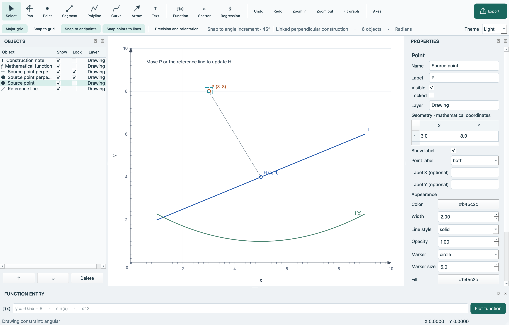
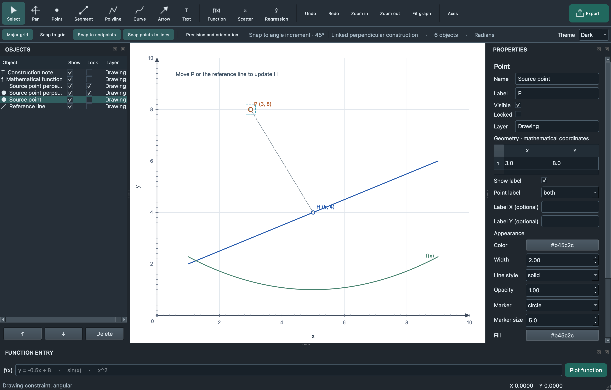
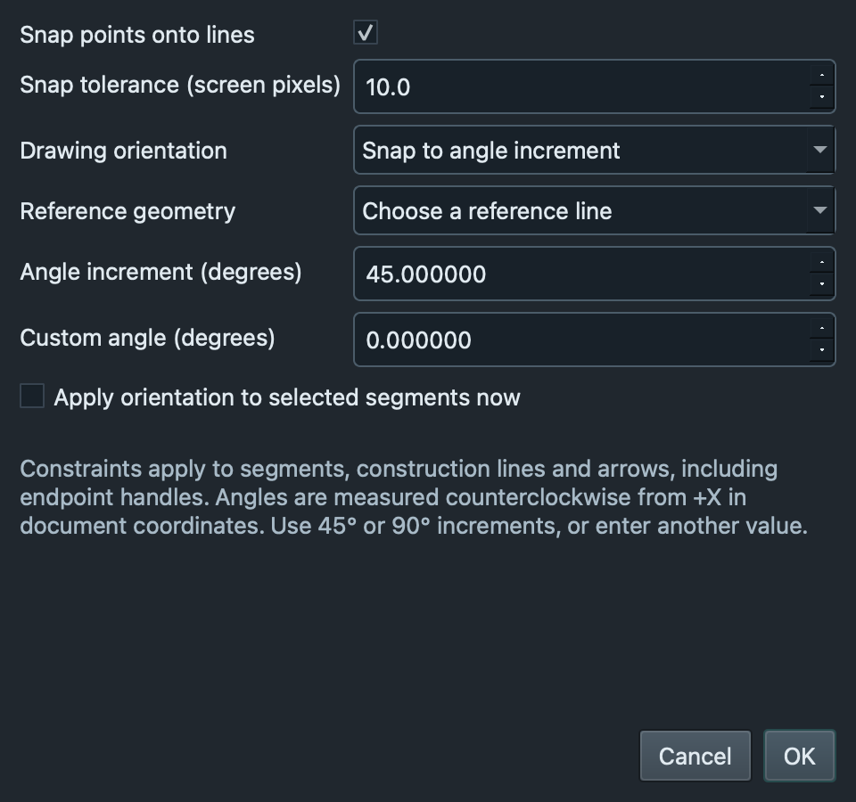
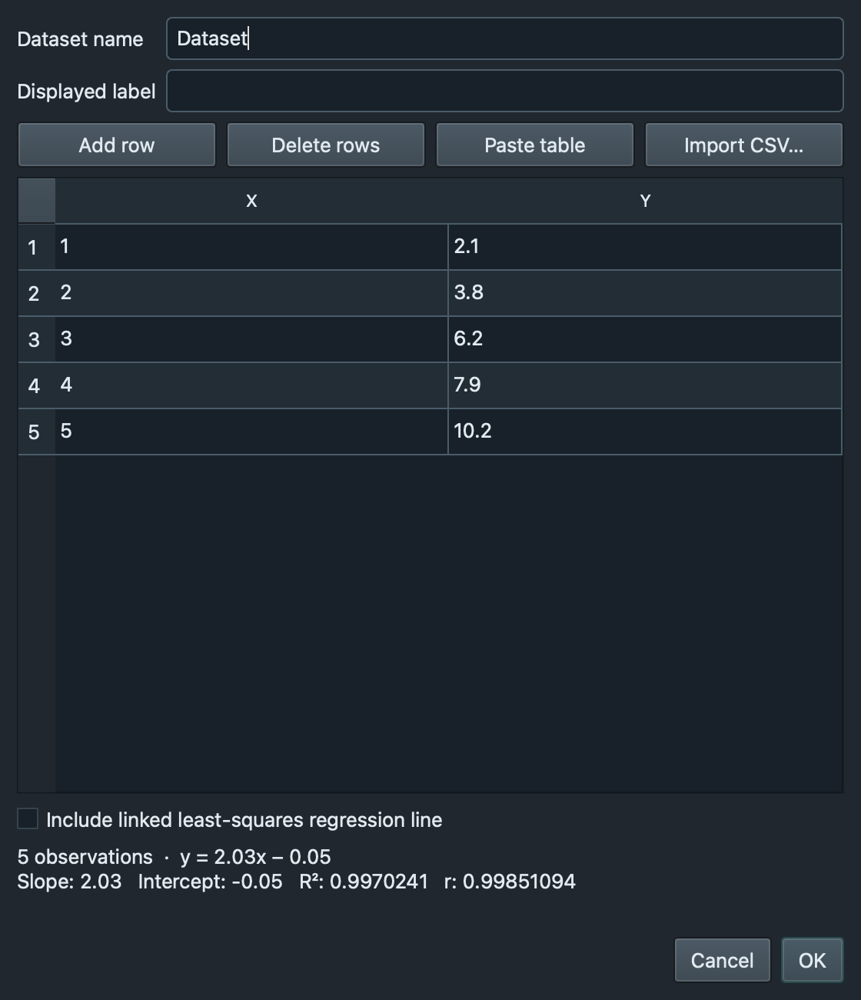

# GraphCad

GraphCad is a native desktop editor for precise two-dimensional graphs and diagrams. It combines manual vector drawing, mathematical function plotting, geometric constructions, and statistical data in one Cartesian coordinate system. It is intended for teachers, students, researchers, and anyone preparing economics, mathematical, or scientific diagrams.


## Contents

- [Features](#features)
- [Screenshots and demonstrations](#screenshots-and-demonstrations)
- [Installation and downloads](#installation-and-downloads)
- [Building from source](#building-from-source)
- [Usage guide](#usage-guide)
- [Exporting and regression](#exporting-and-regression)
- [Project structure](#project-structure)
- [Technology stack and dependencies](#technology-stack-and-dependencies)
- [Testing and quality assurance](#testing-and-quality-assurance)
- [Roadmap](#roadmap)
- [Contributing](#contributing)
- [License](#license)
- [Acknowledgements](#acknowledgements)
- [Support and contact](#support-and-contact)

## Features

### Drawing and graphing

- Native menus, toolbars, dockable Objects/Properties/Function Entry panels, and numerical coordinate editing.
- Editable points, finite and infinite lines, horizontal/vertical segments, construction lines, polylines, smooth interpolating curves, arrows, and multiline text.
- Paint-style arrows: press at the starting point, drag toward the arrowhead, and release.
- Independent object names and displayed labels, colors, line styles, marker styles, fonts, visibility, locking, grouping, ordering, duplication, and clipboard operations.
- Positive-only, four-quadrant, and custom axes with independent ranges, intervals, ticks, labels, titles, arrowheads, decimal/scientific/π formatting, and major/minor grids.
- Pointer-centered zoom, panning, keyboard nudging, endpoint/control handles, and optional snapping.
- Mathematical expressions with implicit multiplication, powers, constants, roots, logarithms, exponential, trigonometric, and inverse trigonometric functions. Radians are the default; degrees are configurable.
- Restricted domains, adaptive function sampling, detected discontinuity gaps, and optional numerical function intersections.
- Editable economics templates including supply/demand, AD–AS, PPC, and cost/revenue diagrams.

### Geometry and precision in 1.1

- **Point-to-line snapping:** project a newly created or moved point onto a finite segment, infinite line, construction line, arrow shaft, or polyline edge. The tolerance is measured in screen pixels while projection is computed in document coordinates.
- **Linked perpendicular construction:** choose a source point and a target straight line or coordinate axis; GraphCad creates a foot point and a perpendicular segment. Moving the source, changing the target, or moving the axis updates the helpers.
- **Orientation controls:** free, horizontal, vertical, parallel/perpendicular to reference geometry, angle increments such as 45°/90°, and custom angles. Constraints work during drawing and endpoint editing; they can also be applied to selected segments through the Precision dialog.
- Active snapping targets and orientation settings are indicated in the editor. These overlays are excluded from exports.

For perpendicular construction to a finite segment, its **supporting infinite line** is used; the perpendicular foot may lie beyond an endpoint. Point snapping to a finite segment is instead clamped to its endpoints. Linked helpers start locked against direct geometry editing. Detach a construction to edit it freely.

### Data, interface, and files

- Editable X/Y tables with CSV/TSV import, tabular paste, scatter plots, and linked linear least-squares regression.
- Regression equation, slope, intercept, coefficient of determination **R²**, and signed Pearson correlation **r**.
- Light, Dark, and System interface themes with a saved preference. Document colors and the white drawing paper remain independent of the interface theme.
- Full-document undo/redo, atomic versioned JSON projects, recent projects, unsaved-change prompts, and reusable templates.
- **1920 × 1080 default PNG export**, custom dimensions and optional aspect-ratio locking, vector PDF/SVG, and CAD DXF.

### Availability and limits

The features above are implemented. The external ODA DWG conversion path remains **unverified with an actual converter**; no DWG writer or converter is bundled. Windows and Intel macOS build configurations are supplied, but those platforms have not been built or run in the macOS Apple Silicon development environment. See [validation results](GraphCad/docs/TEST_RESULTS.md) and [known limitations](#roadmap).

## Screenshots and demonstrations

These screenshots are generated from the application, not interface mockups:

| Light interface | Dark interface |
| --- | --- |
|  |  |





The [editable examples](GraphCad/examples/README.md) include economics, mathematical functions, scatter/regression, and linked perpendicular construction. Open `.graphite` examples with **File → Open**. PNG, vector PDF/SVG, and DXF examples demonstrate actual export output.

## Installation and downloads

Use this repository's [Releases page](../../releases) when binary releases are published. This source delivery has no configured public repository URL and does not claim that a GitHub release has already been published. Releases/Issues links are repository-relative for use after publishing this folder at a repository root.

### macOS

The supplied distribution is `GraphCad-1.1.0-macOS-arm64.dmg`, for **Apple Silicon Macs running macOS 14 or newer**. Open the disk image and drag **GraphCad.app** to Applications, then launch it.

The development build is ad hoc signed, with no Developer ID signature or notarization. If macOS blocks it, use the system's **Open Anyway** option in Privacy & Security only after reviewing the app's source/provenance. Managed Macs may require their administrator's approval. The project does not disable Gatekeeper or remove quarantine attributes.

An Intel Mac must build the source using an Intel Python environment; no Intel binary is supplied in this delivery.

### Windows 11 x64

No prebuilt Windows executable or installer was produced on the macOS host. Run the source or create the native executable on Windows using the exact steps below and the detailed [Windows 11 x64 guide](GraphCad/docs/WINDOWS11.md). A future published Windows build should contain the entire `GraphCad` folder or the Inno Setup installer; `GraphCad.exe` depends on its adjacent runtime files.

## Building from source

### Prerequisites

Use **64-bit CPython 3.12** matching the target computer's architecture. Runtime dependencies are pinned in [requirements.txt](GraphCad/requirements.txt); build/test dependencies are in [requirements-dev.txt](GraphCad/requirements-dev.txt). PySide6 wheels include the Qt runtime; an independent Qt SDK, CMake project, or C++ compiler is not needed for the supported wheel-based build. The Python environment and dependencies must match the target OS; PyInstaller does not create a Windows executable from macOS.

The code uses Python 3.12 and Qt Widgets. macOS bundles target macOS 14+ because of the selected NumPy wheel baseline. Windows instructions target Windows 11 x64, not Windows on ARM.

Download and extract the complete source archive, or clone your own published repository, then open a terminal in the folder containing `run_graphcad.py` and `requirements.txt`.

### Windows 11 x64

Install the official 64-bit Python 3.12 distribution and its Python launcher. In PowerShell:

```powershell
py -3.12 --version
py -3.12 -m venv .venv
.\.venv\Scripts\python.exe -m pip install --only-binary=:all: -r requirements.txt
.\.venv\Scripts\python.exe run_graphcad.py
```

Create and check a standalone executable:

```powershell
.\.venv\Scripts\python.exe -m pip install --only-binary=:all: -r requirements-dev.txt
.\.venv\Scripts\python.exe scripts\build.py --test --work work\pyinstaller
$check = Start-Process -FilePath .\dist\GraphCad\GraphCad.exe -ArgumentList '--verify-build','work\frozen-verification' -Wait -PassThru
if ($check.ExitCode -ne 0) { throw 'Build verification failed' }
.\dist\GraphCad\GraphCad.exe
```

Keep the complete `dist\GraphCad\` directory together, including `_internal`. To create an installer, install Inno Setup 6 and run:

```powershell
& 'C:\Program Files (x86)\Inno Setup 6\ISCC.exe' packaging\windows.iss
```

Expected installer: `dist\GraphCad-1.1.0-Windows-x64-Setup.exe`. These Windows commands are based on the actual build configuration and have not been verified by executing a Windows build here. [WINDOWS11.md](GraphCad/docs/WINDOWS11.md) covers prerequisite installation, outputs, verification, signing, common errors, and platform limits in detail.

### macOS

Install a matching Python 3.12 interpreter. In Terminal:

```sh
python3.12 -m venv .venv
.venv/bin/python -m pip install -r requirements.txt
.venv/bin/python run_graphcad.py
```

Build and verify the native bundle and DMG:

```sh
.venv/bin/python -m pip install -r requirements-dev.txt
.venv/bin/python scripts/build.py --test --work work/pyinstaller
QT_QPA_PLATFORM=offscreen dist/GraphCad.app/Contents/MacOS/GraphCad --verify-build work/frozen-verification
sh packaging/make_dmg.sh
hdiutil verify dist/GraphCad-1.1.0-macOS-arm64.dmg
```

Use an `x86_64` Python on an Intel Mac; the disk image filename follows the build machine's architecture. See [BUILD.md](GraphCad/docs/BUILD.md) for native signing, notarization, offline dependency installation, and CI. Public release signing requires the distributor's own credentials.

### Troubleshooting

- **`py` or Python 3.12 is missing:** install the x64 Python runtime/launcher and reopen PowerShell. `py -0p` lists runtimes with the legacy launcher; the Python Install Manager also supports installing the required runtime. See the Windows guide.
- **No matching wheel:** confirm Python 3.12, 64-bit architecture, and access to the package index. Do not mix ARM, x64, macOS, or Windows environments. `--only-binary=:all:` deliberately avoids an undocumented native compilation path.
- **PowerShell activation is blocked:** use the explicit `.venv\Scripts\python.exe` commands above; activation is unnecessary.
- **Missing Qt platform plugin:** run in a clean virtual environment and clear stale `QT_PLUGIN_PATH`/`QT_QPA_PLATFORM_PLUGIN_PATH` overrides. Keep the packaged runtime folder alongside the executable.
- **Installer compiler not found:** use the actual Inno Setup 6 `ISCC.exe` installation path from your machine.
- **DWG export asks for a converter:** install ODA File Converter separately under its own license; see [EXPORTS.md](GraphCad/docs/EXPORTS.md). PNG/PDF/SVG/DXF do not need it.

## Usage guide

### Draw and edit

Choose **File → New graph** for a template, then **Graph → Coordinate system** for axes, intervals, labels, grids and snapping. Major interval `0` means automatic; minor interval `0` disables minor ticks. Axis settings and view zoom are independent.

Choose Point (`P`), Segment (`L`), Arrow (`A`), Text (`T`), Curve (`C`), or Polyline. For segments and arrows, press, drag, and release. For curves/polylines, click knots, then double-click or Enter to finish. Escape cancels. Select (`V`) an object and drag it or its handles. Shift-click selects several objects. Apply exact coordinates and styles in Properties. Use the Objects list to rename, show/hide, lock, reorder, group, duplicate or delete objects.

Wheel/trackpad zooms around the pointer. Pan using the middle button, Space + drag, or Pan (`H`). **Fit graph** restores the saved axis range. Ctrl/Cmd + N/O/S, Z/Shift+Z, C/V/D and Delete provide familiar document operations; tool letters apply while the canvas has focus.

### Snap points and constrain directions

Enable **Snap points to lines** in the Precision toolbar or View menu. **Tools → Precision and orientation** configures screen-pixel tolerance. Point placement and point dragging can snap to the full shaft of a compatible line. Endpoints/intersections retain priority when their snapping options are enabled; a highlighted target and marker show the active snap.

The same dialog selects Free, Horizontal, Vertical, Parallel, Perpendicular, Angle increment, or Custom angle. Select reference geometry in the dialog for parallel/perpendicular modes. Angles are measured counterclockwise from +X in mathematical coordinates, so zoom and different X/Y scales do not change them. With unequal X/Y display scales, mathematical angles may appear different onscreen. The active orientation is displayed beside the Precision action. Check **Apply orientation to selected segments now** to orient existing editable segments/arrows. This changes geometry once; it does not create a persistent parallel/perpendicular relationship between ordinary lines.

### Construct a linked perpendicular

Create a point and a straight line, optionally select both, and choose **Object → Perpendicular from point**. Choose the source and target (including X or Y axis). GraphCad adds a linked foot point and connecting segment using the existing object/style/visibility system. Source and target edits update the helpers, including after undo/redo and reopening a project.

Finite targets are treated as supporting lines; zero-length targets cannot define a direction and are rejected. A source already on the target produces a coincident foot and a zero-length connecting segment. If a target becomes temporarily degenerate, the last valid helper geometry is retained until it becomes valid again. Deleting a source or target freezes and detaches the remaining helpers. **Object → Detach linked construction** removes the relationship and unlocks the helpers for direct editing.

### Plot functions and analyze data

Type an expression in Function Entry and press Enter, or choose **Graph → Add function** for domain limits. Examples: `y = -0.5x + 8`, `x^2`, `sin(x)`, `sqrt(x)`, `ln(x)`, `1/x`. The parser accepts arithmetic and listed math functions, not arbitrary Python code.

Choose **Graph → Scatter plot / dataset** to enter X/Y values, import UTF-8 CSV/TSV, or paste two columns. Enable linked regression. Double-click a dataset or its regression object to reopen the data table and statistics; changes update the fit. Select a scatter object and use **Object → Convert scatter to points** for independent editable observations.

Use **View → Interface theme** or the **Theme** selector for Light, Dark, or System. The preference is saved for the next session. System mode follows Qt's detected system color scheme where the platform provides it. The drawing paper stays white and object colors are unchanged.

## Exporting and regression

### Formats and dimensions

The compact **Export** button or **File → Export** opens the existing export workflow. PNG defaults to **1920 × 1080 pixels**. Enter custom width and height; disable **Keep aspect ratio** to change them independently. Output dimensions are independent of the window size and display scaling. Rendering uses document geometry, not a screenshot.

| Format | Status | Notes |
| --- | --- | --- |
| PNG | Implemented and tested | Requested pixel dimensions, antialiasing, solid/transparent background; Full HD default |
| PDF | Implemented and tested | Vector paths and text; A4, Letter or custom paper; landscape/portrait |
| SVG | Implemented and tested | Vector paths and text |
| DXF | Implemented and tested by readback/audit | Editable CAD entities, world coordinates, layers; curves/functions sampled as polylines |
| DWG | Optional external integration | Requires ODA File Converter; actual conversion/CAD viewer compatibility remains unverified |

Choose saved graph ranges, current view, or a custom coordinate region; switch axes, grids, and labels independently. Selection handles, snapping highlights and other editor overlays are excluded. Styles and export colors are the same in light and dark interface themes. Content outside the chosen coordinate region is intentionally cropped; text labels may occupy the reserved axis margins. Extreme aspect ratios and labels placed far outside the document range can require a larger region or adjusted margins.

### Statistical meanings

For an ordinary least-squares line `y = m x + b`, GraphCad reports slope `m`, intercept `b`, the equation, **R²**, and **r**. Pearson `r` is computed directly from centered X/Y products and lies between −1 and +1; its sign indicates the direction of linear association. R² measures the proportion of Y variation explained by the fitted line. With an intercept and nonconstant variables, R² equals r²; `r` is not a signed version of a percentage.

`r` is displayed as **undefined** with fewer than two observations or when either variable is constant. The line fit also requires at least two distinct X values. For a constant Y response, the existing exact-fit R² convention is 1 while `r` remains undefined. Statistics recompute when the dataset changes and use the existing eight-significant-digit presentation.

## Project structure

```text
GraphCad/
├── graphite/                 # Preserved Python namespace
│   ├── app.py, themes.py     # Lifecycle, branding, interface themes
│   ├── window.py             # Native menus, docks and document commands
│   ├── dialogs.py, inspector.py
│   ├── model.py, history.py  # Validated documents, atomic JSON, transactions
│   ├── geometry.py          # Transforms, projections and constraints
│   ├── constructions.py     # Linked perpendicular dependencies
│   ├── canvas.py, render.py # Editing gestures and shared vector rendering
│   ├── expressions.py       # Restricted math parser/adaptive sampling
│   ├── data.py, export.py, templates.py
├── run_graphcad.py           # Primary source/frozen entry point
├── run_graphite.py           # Compatible older entry point
├── GraphCad.spec             # Native PyInstaller configuration
├── requirements*.txt, pyproject.toml
├── packaging/               # SVG icon, DMG script, Inno installer, notices
├── scripts/                 # Build and example generation
├── tests/                   # Geometry, math, UI, persistence, export tests
├── examples/                # Editable projects and actual exports
├── docs/                    # Build, Windows, format, architecture and QA
└── .github/workflows/build.yml
```

GraphCad continues reading existing `.graphite`/`.graphproj` projects and retains `graphite-document` and the versioned JSON structure. New snapping preferences and construction metadata are optional when loading old documents. Earlier Graphite versions may reject newer document fields; use GraphCad to edit projects saved with these additions. The Python namespace, legacy environment variables and platform document association identifiers are intentionally retained for compatibility. See [FORMAT.md](GraphCad/docs/FORMAT.md).

## Technology stack and dependencies

| Component | Version/baseline | Role | Official documentation |
| --- | --- | --- | --- |
| Python | 3.12; tested runtime recorded in QA report | Application language | [Python](https://docs.python.org/3.12/) |
| PySide6 / Qt | 6.10.2 | Native Widgets, vectors, PNG/PDF/SVG | [Qt for Python](https://doc.qt.io/qtforpython-6/) |
| ezdxf | 1.4.5 | CAD DXF export | [ezdxf](https://ezdxf.readthedocs.io/) |
| NumPy | 2.5.4 | ezdxf dependency | [NumPy](https://numpy.org/doc/) |
| fonttools / pyparsing / typing_extensions | Pinned in requirements | Supporting runtime dependencies | [Requirements](requirements.txt) |
| PyInstaller | 6.22.3 | Native executable/bundle packaging | [PyInstaller](https://pyinstaller.org/en/stable/) |
| pytest | 9.2.0 | Automated checks | [pytest](https://docs.pytest.org/) |
| PyMuPDF | 2.0, development only | Inspect PDF output in tests | [PyMuPDF](https://pymupdf.readthedocs.io/) |
| Inno Setup | 6.x, Windows packaging only | Optional installer | [Inno Setup](https://jrsoftware.org/isinfo.php) |

The application has no hosted backend or ordinary-use network requirement. Dependency installation needs a package source or matching offline wheels. [LICENSES.md](GraphCad/docs/LICENSES.md) explains MIT, Qt/PySide LGPL/GPL or commercial terms, dependency notices, test-only PyMuPDF terms, and the separate optional ODA license. Third-party license files are collected into native bundles.

## Testing and quality assurance

Install development dependencies and run:

```sh
python -m pytest -q
```

Here `python` means the virtual environment executable shown in the platform instructions. Tests use Qt's offscreen platform and cover existing editor behavior plus line projection/snapping, perpendicular dependency updates, geometric angle constraints, theme persistence, export color stability/dimensions, and known correlation datasets. [TEST_RESULTS.md](GraphCad/docs/TEST_RESULTS.md) records actual counts, build details and unverified platforms; results are not inferred from compilation.

The build's `--test` option runs the suite before freezing. The installed application's `--verify-build DIRECTORY` command checks editable saving/reopening and PNG/PDF/SVG/DXF output using its bundled dependencies, writing an inspectable JSON report. Native macOS startup, screenshots, signature integrity, and the DMG are checked separately. The supplied CI workflow builds each configured platform on its own runner; a supplied workflow is not a claim that CI has already run.

## Roadmap

Relevant future work, **not currently implemented**, includes:

- Actual Windows x64 and Intel Mac release verification and published signed installers.
- ODA conversion verification in a licensed installation and intended CAD viewers.
- Hierarchical layer management and per-layer style/visibility controls.
- Independent Bézier tangent handles, symbolic calculus, implicit/parametric functions, and polynomial regression.
- LaTeX typesetting and richer attached-label editing.
- Larger-document performance benchmarking and memory-efficient history.

Known limits: mathematical intersections use finite sampled crossings and may miss tangent contacts or very close roots; highly oscillatory functions have bounded sampling resolution. Intersection snapping caps the segment-pair search. Text supports Unicode mathematical characters, not a LaTeX layout engine. CAD viewers may substitute fonts and render marker/line styles differently. Core data limits are documented in the model and existing README history; maximum-size performance is not exhaustively benchmarked.

## Contributing

Use this repository's [Issues page](../../issues) to report bugs or propose features. For bugs include the GraphCad version, OS/architecture, exact steps, expected/actual behavior, and a minimal `.graphite` example if possible. Avoid posting private datasets or personal information.

For code changes, create a focused branch, retain mathematical world coordinates and document compatibility, and commit a coherent undo transaction for each user action. Add meaningful tests for changed behavior and edge cases. Run the existing suite and build on the affected target OS when possible. Keep documentation consistent with actual functionality. Submit a pull request describing the problem, resulting behavior, tests run, and remaining platform gaps.

## License

GraphCad uses the existing **MIT License** in [LICENSE](LICENSE). The original Graphite contributors' copyright notice is retained. Third-party dependencies keep their own licenses; the MIT application license does not replace Qt/PySide, Python, PyInstaller, or optional ODA obligations. See [dependency and redistribution notices](GraphCad/docs/LICENSES.md) before distributing a release.

## Acknowledgements

GraphCad builds on the original Graphite editor and the work of the Python, Qt/PySide, ezdxf, NumPy, fonttools, pyparsing, typing_extensions, PyInstaller, pytest, and PyMuPDF communities. The application icon is an original vector asset. These acknowledgements do not imply endorsement by the named projects.

## Support and contact

Use [GitHub Issues](../../issues) in the repository where this source is published. No email address, maintainer contact, or public repository identity has been supplied, so none is invented here. Until publication, include errors and diagnostic output when following up through the channel where the source was delivered.
